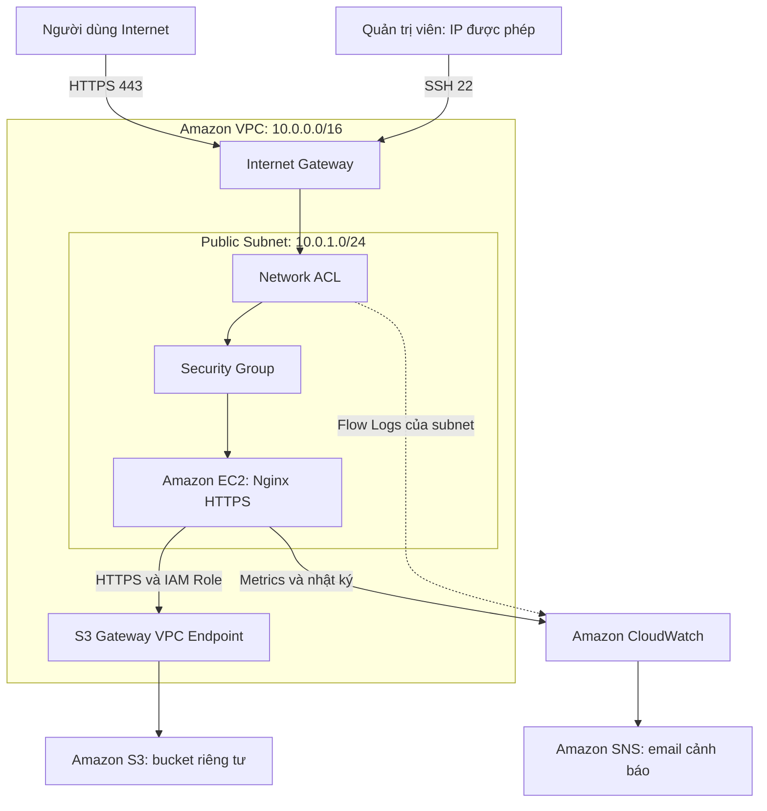

# Thiết kế và triển khai hệ thống Web Server bảo mật trên AWS sử dụng VPC, EC2, S3 và CloudWatch

## 2.1 Tóm tắt

Dự án đề xuất xây dựng hệ thống Web Server trên AWS với trọng tâm là kiểm soát truy cập mạng, bảo vệ dữ liệu và giám sát vận hành. Bốn dịch vụ chính gồm Amazon VPC, Amazon EC2, Amazon S3 và Amazon CloudWatch; AWS IAM cùng các thành phần hỗ trợ được sử dụng để phân quyền và gửi cảnh báo.

Amazon VPC cung cấp môi trường mạng riêng, kết hợp Security Group và Network ACL làm các lớp lọc lưu lượng. Amazon EC2 vận hành Web Server sử dụng Nginx và HTTPS. Amazon S3 lưu trữ tài nguyên website cùng bản sao lưu trong bucket riêng tư, có mã hóa và quản lý phiên bản. Amazon CloudWatch tập trung số liệu, nhật ký và cảnh báo để hỗ trợ phát hiện bất thường.

Dự án được thực hiện bởi nhóm 4 thành viên, mỗi thành viên phụ trách một dịch vụ chính và xây dựng phần workshop tương ứng. Thời gian đề xuất là 6 tuần kể từ khi bắt đầu triển khai.

Kết quả bàn giao gồm hệ thống thử nghiệm hoạt động được, sơ đồ kiến trúc, cấu hình bảo mật, bộ kiểm thử có minh chứng, dashboard giám sát và workshop bằng Markdown. Đây là mô hình thực hành có kiểm chứng, chưa phải hệ thống có tính sẵn sàng cao cho môi trường sản xuất.

## 2.2 Vấn đề

### 2.2.1 Kiểm soát truy cập mạng chưa chặt chẽ

Một Web Server đưa trực tiếp lên Internet có thể bị dò cổng và thử đăng nhập trái phép. Việc mở SSH cho mọi địa chỉ IP hoặc cho phép quá nhiều cổng làm tăng phạm vi có thể bị khai thác.

**Yêu cầu:** Chỉ mở các cổng cần thiết, giới hạn nguồn quản trị và chứng minh được cả trường hợp truy cập hợp lệ lẫn truy cập bị từ chối.

### 2.2.2 Nguy cơ lộ và mất dữ liệu

Bucket công khai ngoài ý muốn, quyền IAM quá rộng hoặc khóa truy cập được lưu trong mã nguồn đều có thể làm lộ dữ liệu. Việc ghi đè hoặc xóa nhầm tệp cũng gây khó khăn nếu chưa có cơ chế khôi phục.

**Yêu cầu:** Giữ S3 riêng tư, dùng IAM Role với quyền tối thiểu, mã hóa dữ liệu và thử nghiệm khôi phục phiên bản.

### 2.2.3 Thiếu quan sát và cảnh báo

Nếu chỉ kiểm tra website bằng trình duyệt, nhóm khó nhận biết nguyên nhân khi website chậm hoặc không truy cập được. Nhật ký nằm riêng trên máy chủ cũng gây khó khăn cho việc đối chiếu sự cố.

**Yêu cầu:** Thu thập CPU, bộ nhớ, dung lượng đĩa, nhật ký Nginx và VPC Flow Logs; xây dựng dashboard và cảnh báo có thể kiểm thử.

### 2.2.4 Khó tái hiện và bàn giao hệ thống

Các thao tác thủ công không được ghi lại dễ dẫn đến sai khác cấu hình giữa các thành viên. Thiếu tiêu chí nghiệm thu khiến việc đánh giá mức độ hoàn thành không rõ ràng.

**Yêu cầu:** Thống nhất thông số, phân công trách nhiệm, ghi lại thao tác AWS Console, lưu cấu hình mẫu và minh chứng kiểm thử.

### 2.2.5 Giới hạn ngân sách thực hành

Chi phí có thể phát sinh từ EC2, ổ EBS, IPv4 công khai, dữ liệu truyền ra Internet và CloudWatch. Dừng EC2 không đồng nghĩa tất cả tài nguyên đều ngừng tính phí.

**Yêu cầu:** Dự trù ngân sách, giới hạn dữ liệu nhật ký, theo dõi chi phí và có quy trình dọn dẹp.

## 2.3 Kiến trúc giải pháp

### 2.3.1 Phạm vi và giả định

- Triển khai tại một AWS Region, đề xuất Singapore (`ap-southeast-1`).
- Một VPC, một Public Subnet và một EC2 cho môi trường thực hành.
- Website giới thiệu hoặc website demo đơn giản; không xử lý dữ liệu cá nhân thật.
- EC2 chạy Linux, Nginx và sử dụng ổ EBS được mã hóa.
- S3 chứa tài nguyên website và bản sao lưu; không bật public website hosting.
- Có tên miền do nhóm quản lý để cấu hình HTTPS bằng chứng chỉ được tin cậy. Nếu chưa có tên miền, chứng chỉ tự ký chỉ dùng kiểm tra mã hóa trong lab và phải ghi rõ hạn chế.
- Triển khai chủ yếu bằng AWS Management Console; cấu hình Linux, Nginx và các phép thử được thực hiện trên EC2.
- IAM, EBS, SNS và công cụ theo dõi ngân sách là thành phần hỗ trợ; bốn dịch vụ trọng tâm vẫn là VPC, EC2, S3 và CloudWatch.

### 2.3.2 Sơ đồ kiến trúc

S3 và CloudWatch là các dịch vụ AWS bên ngoài subnet. S3 Gateway Endpoint cung cấp tuyến truy cập S3 từ VPC; nó không đưa bucket vào subnet. Nhật ký luồng được tạo bằng VPC Flow Logs ở cấp subnet, không phải nhật ký do bản thân NACL phát ra.

### 2.3.3 Luồng truy cập website

1. Người dùng gửi yêu cầu HTTPS đến tên miền trỏ về địa chỉ IPv4 công khai của EC2.
2. Internet Gateway cùng Route Table cung cấp đường kết nối Internet của Public Subnet.
3. Network ACL kiểm soát lưu lượng ở cấp subnet; Security Group kiểm soát lưu lượng đến EC2.
4. Nginx kết thúc kết nối TLS và trả nội dung website.
5. EC2 ghi access log và error log; CloudWatch Agent chuyển các tệp log đã cấu hình đến CloudWatch Logs.

Cổng 80 chỉ phục vụ chuyển hướng sang HTTPS và xác thực/gia hạn chứng chỉ khi phương thức cấp chứng chỉ yêu cầu. Không truyền thông tin nhạy cảm qua HTTP.

### 2.3.4 Luồng truy cập và sao lưu S3

1. EC2 nhận thông tin xác thực tạm thời thông qua IAM Role gắn với instance.
2. EC2 đọc tài nguyên tại prefix `assets/` và ghi bản sao lưu tại prefix `backups/`.
3. Lưu lượng S3 đi qua Gateway Endpoint được liên kết với Route Table của subnet.
4. IAM Policy, bucket policy và endpoint policy giới hạn quyền thao tác.
5. Dữ liệu lưu trên S3 được mã hóa; Versioning hỗ trợ khôi phục khi ghi đè hoặc xóa nhầm.

Nội dung công khai của website được EC2 tải từ S3 về thư mục phục vụ web. Không đặt thông tin bí mật trong prefix dùng để xuất bản website. Người dùng không truy cập bucket trực tiếp và Nginx không tự đọc S3 nếu chưa có bước đồng bộ hoặc ứng dụng tích hợp.

### 2.3.5 Vai trò từng thành phần

| Thành phần | Vai trò |
|---|---|
| VPC, Public Subnet | Phân vùng mạng cho EC2 |
| Internet Gateway, Route Table | Định tuyến lưu lượng Internet |
| Security Group | Cho phép lưu lượng cần thiết ở cấp tài nguyên, có trạng thái |
| Network ACL | Cho phép/từ chối lưu lượng ở cấp subnet, không trạng thái |
| S3 Gateway Endpoint | Đường truy cập S3 từ VPC không cần NAT Gateway |
| EC2 và Nginx | Vận hành website, xử lý HTTPS |
| EBS mã hóa | Lưu hệ điều hành và dữ liệu cục bộ |
| S3 | Lưu tài nguyên và bản sao lưu có quản lý phiên bản |
| IAM Role | Cấp quyền tạm thời cho EC2 |
| CloudWatch | Thu thập metrics, logs, dashboard và alarms |
| SNS | Gửi thông báo khi alarm thay đổi trạng thái |

## 2.4 Các quyết định đánh đổi kiến trúc

### 2.4.1 EC2 trong Public Subnet và chi phí hạ tầng

**Quyết định:** Đặt một EC2 trong Public Subnet, dùng Security Group giới hạn cổng và nguồn truy cập.

**Lợi ích:** Phù hợp phạm vi thực hành, dễ cấu hình, không cần ALB hoặc NAT Gateway.

**Đánh đổi:** EC2 trực tiếp tiếp nhận lưu lượng Internet và là điểm lỗi đơn. Giới hạn này phải được ghi nhận, không coi mô hình là kiến trúc sẵn sàng cao.

**Hướng mở rộng:** Đặt EC2 trong Private Subnet, tiếp nhận lưu lượng qua ALB và triển khai nhiều Availability Zone khi có nhu cầu.

### 2.4.2 Firewall mạng và bảo vệ tầng ứng dụng

**Quyết định:** Dùng Security Group làm cơ chế kiểm soát chính, Network ACL làm lớp bổ sung để minh họa lọc và từ chối lưu lượng.

**Lợi ích:** Đáp ứng mục tiêu học về cổng, giao thức, nguồn truy cập và khác biệt stateful/stateless.

**Đánh đổi:** Hai thành phần này không phân tích nội dung HTTP để ngăn SQL injection hoặc XSS. Dự án không triển khai dịch vụ AWS Network Firewall hay AWS WAF ở giai đoạn cơ bản.

**Hướng mở rộng:** Bổ sung AWS WAF thông qua một dịch vụ tích hợp phù hợp như ALB hoặc CloudFront; kết hợp kiểm tra bảo mật mã ứng dụng.

### 2.4.3 S3 riêng tư và cách phân phối nội dung

**Quyết định:** Bật Block Public Access, dùng EC2 làm điểm phục vụ nội dung.

**Lợi ích:** Bucket không cần công khai; có thể giới hạn quyền theo role và prefix.

**Đánh đổi:** Nhóm phải xây dựng bước đồng bộ tài nguyên từ S3 đến EC2. EC2 chịu tải phân phối nội dung website.

**Hướng mở rộng:** Dùng CloudFront với Origin Access Control cho nội dung S3 riêng tư.

### 2.4.4 SSE-S3 và SSE-KMS

**Quyết định:** Dùng SSE-S3 cho dữ liệu S3 trong phạm vi cơ bản và xác minh thuộc tính mã hóa sau khi tải lên.

**Lợi ích:** Cấu hình đơn giản, phù hợp dữ liệu demo.

**Đánh đổi:** Chưa có mức kiểm soát khóa riêng như khi dùng khóa KMS do khách hàng quản lý.

**Hướng mở rộng:** Chuyển dữ liệu cần kiểm soát khóa sang SSE-KMS, đồng thời thiết kế key policy và dự trù chi phí tương ứng.

### 2.4.5 Khả năng quan sát và chi phí

**Quyết định:** Chỉ thu thập metrics cần thiết, giữ nhật ký CloudWatch trong 7 ngày ở giai đoạn lab.

**Lợi ích:** Đủ phục vụ kiểm thử và giảm lượng dữ liệu lưu trữ.

**Đánh đổi:** Khả năng điều tra sự cố cũ bị giới hạn. Chu kỳ lưu giữ phải tăng khi chuyển sang vận hành thực tế.

## 2.5 Triển khai kỹ thuật

### 2.5.1 Chuẩn bị và quy ước

- Xác nhận tài khoản AWS hoạt động và quyền triển khai của từng thành viên.
- Bật MFA cho tài khoản quản trị; không dùng root cho thao tác hằng ngày.
- Thống nhất Region, địa chỉ IP quản trị và tên miền.
- Gắn tag `Project=SecureWebServer`, `Environment=Lab`, `Owner=<thanh-vien>`.
- Không đưa access key, private key, mật khẩu hoặc dữ liệu nhạy cảm vào workshop.
- Các tên tài nguyên bên dưới là giá trị đề xuất, có thể điều chỉnh trước khi triển khai.

| Tài nguyên | Giá trị đề xuất |
|---|---|
| VPC | `vpc-secure-web`, CIDR `10.0.0.0/16` |
| Public Subnet | `subnet-web-public`, CIDR `10.0.1.0/24` |
| Route Table | `rtb-web-public` |
| Security Group | `sg-secure-web` |
| EC2 | `ec2-secure-web` |
| S3 bucket | `secure-web-<account-id>-<region>-<suffix>` |
| CloudWatch Dashboard | `secure-web-dashboard` |

### 2.5.2 Thiết kế mạng và Firewall — Thành viên 1

1. Tạo VPC và Public Subnet; bật DNS resolution và DNS hostnames.
2. Tạo Internet Gateway và gắn vào VPC.
3. Liên kết Route Table với subnet; thêm tuyến `0.0.0.0/0` tới Internet Gateway.
4. Tạo Security Group theo bảng dưới.
5. Tạo Network ACL tùy chỉnh, khai báo cả hai chiều và lưu lượng phản hồi.
6. Tạo S3 Gateway Endpoint cùng Region, liên kết với Route Table của EC2.
7. Phối hợp thành viên 4 bật VPC Flow Logs đến CloudWatch Logs.

**Security Group inbound:**

| Cổng | Giao thức | Nguồn | Mục đích |
|---|---|---|---|
| 22 | TCP | `<IP-quan-tri>/32` | Quản trị SSH |
| 80 | TCP | `0.0.0.0/0` | Chuyển hướng HTTPS, xác thực chứng chỉ nếu cần |
| 443 | TCP | `0.0.0.0/0` | Truy cập website HTTPS |

Không tạo inbound rule cho các cổng không sử dụng. Outbound cho phép HTTPS phục vụ S3, CloudWatch và các phụ thuộc cần thiết; chỉ bổ sung HTTP hoặc đích khác khi kho cập nhật/phụ thuộc thực tế yêu cầu. Với S3, có thể tham chiếu AWS-managed prefix list trong Security Group.

Network ACL cần cho phép đúng cổng dịch vụ và cổng tạm thời phục vụ phản hồi; cấu hình theo chiều kết nối thực tế. Khi minh họa chặn một IP, đặt rule DENY có số thứ tự nhỏ hơn rule ALLOW phù hợp. Ghi lại cấu hình trước khi thay đổi để khôi phục.

### 2.5.3 Triển khai Web Server — Thành viên 2

1. Tạo EC2 Linux, đề xuất `t3.micro` cho website demo.
2. Dùng EBS gp3 10 GB có bật mã hóa; gắn Security Group đã thống nhất.
3. Gắn IAM Role do nhóm thiết kế, yêu cầu IMDSv2.
4. Cập nhật hệ điều hành và cài Nginx.
5. Đưa website demo vào thư mục phục vụ web; cấu hình quyền tệp phù hợp.
6. Cấu hình tên miền, TLS và cơ chế gia hạn chứng chỉ.
7. Chuyển hướng HTTP sang HTTPS; kiểm tra chuỗi chứng chỉ và thời hạn.
8. Giới hạn đăng nhập SSH bằng khóa; tắt đăng nhập root từ xa và xác thực bằng mật khẩu sau khi kiểm tra kết nối quản trị.
9. Cài AWS CLI để thực hiện tác vụ S3 bằng IAM Role, không cấu hình access key tĩnh.
10. Phối hợp thành viên S3 thiết lập đồng bộ tài nguyên và tác vụ sao lưu bằng systemd timer hoặc cron.

Gói sao lưu gồm nội dung website, cấu hình Nginx và hướng dẫn dựng lại dịch vụ. Không đưa khóa riêng TLS hoặc khóa SSH vào gói demo. Quy trình khôi phục phải có bước cấp lại chứng chỉ khi cần.

### 2.5.4 Lưu trữ và bảo mật dữ liệu — Thành viên 3

1. Tạo bucket riêng tư cùng Region với VPC.
2. Giữ toàn bộ tùy chọn Block Public Access; sử dụng Object Ownership phù hợp để tránh phụ thuộc ACL.
3. Xác minh mã hóa mặc định SSE-S3.
4. Bật Versioning trước khi thực hiện các phép thử ghi đè/xóa.
5. Tạo prefix `assets/` và `backups/`.
6. Cấp IAM Role của EC2 quyền đọc `assets/`, ghi/đọc `backups/` và liệt kê bucket theo phạm vi cần thiết. Không cấp `s3:*`.
7. Dùng bucket policy từ chối yêu cầu không sử dụng TLS.
8. Giới hạn endpoint policy tới bucket và các hành động cần thiết.
9. Nếu áp dụng điều kiện `aws:SourceVpce`, giới hạn vào luồng dữ liệu đã thiết kế và kiểm thử quyền quản trị trước; không chặn toàn bộ bucket một cách máy móc.
10. Đề xuất giữ bản sao lưu 30 ngày, phiên bản cũ 7 ngày bằng Lifecycle sau khi hoàn tất kiểm thử và thống nhất nhu cầu giữ dữ liệu.

Các yêu cầu từ AWS Console không mặc nhiên đi qua Gateway Endpoint của VPC. Vì vậy, chính sách bắt buộc endpoint có thể chặn thao tác quản trị từ Console nếu không được thiết kế đúng.

Versioning hỗ trợ khôi phục phiên bản nhưng không thay thế một chiến lược backup độc lập trước sự cố mất tài khoản hoặc xóa vĩnh viễn mọi phiên bản. Sao lưu khác tài khoản/Region là hướng mở rộng.

### 2.5.5 Giám sát và cảnh báo — Thành viên 4

1. Tạo Log Group với retention 7 ngày.
2. Cấu hình IAM Role cho CloudWatch Agent với quyền ghi log và metrics cần thiết.
3. Thu thập CPU, network và status check của EC2.
4. Cài CloudWatch Agent để bổ sung bộ nhớ, dung lượng đĩa và log Nginx.
5. Bật VPC Flow Logs để phân tích bản ghi ACCEPT/REJECT.
6. Tạo Dashboard thể hiện tài nguyên, trạng thái máy chủ và lỗi web.
7. Tạo metric filter cho log HTTP 5xx theo đúng định dạng access log.
8. Tạo SNS topic và đăng ký email người phụ trách; hoàn thành xác nhận đăng ký.
9. Kiểm thử alarm bằng tải có kiểm soát và lưu bằng chứng thông báo.

| Tín hiệu | Ngưỡng đề xuất ban đầu | Cách xử lý |
|---|---|---|
| CPUUtilization | Trên 80% trong 3 chu kỳ, mỗi chu kỳ 5 phút | Kiểm tra tiến trình và lưu lượng |
| mem_used_percent | Trên 80% trong 3 chu kỳ, mỗi chu kỳ 1 phút | Kiểm tra bộ nhớ ứng dụng |
| disk_used_percent | Trên 80% trong 3 chu kỳ, mỗi chu kỳ 1 phút | Kiểm tra log và dữ liệu cục bộ |
| StatusCheckFailed | Từ 1 trong 2 chu kỳ, mỗi chu kỳ 1 phút | Kiểm tra tình trạng instance |
| HTTP 5xx | Từ 5 lỗi trong 5 phút | Đối chiếu access/error log |

Đây là ngưỡng thử nghiệm, sẽ điều chỉnh sau khi quan sát tải nền. Metrics bộ nhớ và dung lượng filesystem cần agent, không phải metrics EC2 mặc định. Flow Logs có độ trễ và không chứa nội dung gói tin; bản ghi REJECT cần được đối chiếu cấu hình để xác định nguyên nhân.

### 2.5.6 Kiểm thử tích hợp và bảo mật

| Mã | Kịch bản | Kết quả cần đạt | Minh chứng |
|---|---|---|---|
| T01 | Truy cập tên miền bằng HTTPS | Website hiển thị, chứng chỉ hợp lệ với tên miền | Trình duyệt và kiểm tra TLS |
| T02 | Truy cập HTTP | Chuyển hướng sang HTTPS | HTTP response |
| T03 | SSH từ IP được phép | Kết nối thành công bằng khóa | Kết quả SSH |
| T04 | SSH từ nguồn khác và kết nối cổng không mở | Không thiết lập được kết nối | Kết quả từ nguồn thử thứ hai |
| T05 | Tạm chặn IP thử nghiệm bằng NACL | Yêu cầu mới bị chặn; hoạt động lại sau hoàn tác | Rule, kết quả thử và Flow Logs |
| T06 | Đọc object S3 không có xác thực | Truy cập bị từ chối | Kết quả yêu cầu |
| T07 | EC2 đọc/ghi đúng prefix được cấp | Thao tác thành công qua IAM Role | CLI output và object |
| T08 | EC2 thao tác ngoài phạm vi IAM | AccessDenied | CLI output |
| T09 | Kiểm tra object vừa tải lên | Thuộc tính mã hóa đúng thiết kế | Thuộc tính object |
| T10 | Ghi đè/xóa thử object, phục hồi | Khôi phục đúng nội dung, kiểm tra checksum | Version ID và checksum |
| T11 | Kích hoạt điều kiện cảnh báo | Alarm đổi trạng thái, email được nhận | Alarm history và email |
| T12 | Gửi yêu cầu tạo log | Có log web, metrics và Flow Logs sau thời gian thu thập | Dashboard và log query |
| T13 | Dựng lại website từ backup | Website hoạt động, nội dung đúng | Biên bản phục hồi, thời gian đo |

Chỉ thực hiện kiểm thử trên tài nguyên của nhóm. Dùng dữ liệu giả, thay đổi từng cấu hình một và hoàn tác rule thử nghiệm sau khi thu đủ minh chứng.

## 2.6 Lộ trình

### 2.6.1 Kế hoạch 6 tuần

| Tuần | Công việc | Đầu ra |
|---|---|---|
| 1 | Khảo sát yêu cầu, chốt phạm vi, kiến trúc, IAM và ngân sách | Bản đề xuất, sơ đồ, danh sách tài nguyên |
| 2 | Tạo VPC, subnet, route, Security Group, NACL; chuẩn bị bucket và role | Hạ tầng mạng và phân quyền cơ bản |
| 3 | Cài EC2, Nginx, HTTPS; cấu hình S3, endpoint và đồng bộ dữ liệu | Website HTTPS tích hợp S3 |
| 4 | Triển khai CloudWatch Agent, Flow Logs, dashboard, alarms và sao lưu | Giám sát và tác vụ backup hoạt động |
| 5 | Kiểm thử T01–T13, sửa cấu hình, đo phục hồi | Bảng kết quả và minh chứng |
| 6 | Hoàn thiện workshop, video demo, rà soát chi phí, bàn giao/dọn dẹp | Bộ tài liệu và bản tổng kết |

Mốc tuần được tính từ ngày nhóm bắt đầu dự án; có thể ánh xạ vào lịch thực tập chính thức.

### 2.6.2 Phân công 4 thành viên

| Thành viên | Phụ trách chính | Sản phẩm bàn giao | Phối hợp |
|---|---|---|---|
| 1 | VPC và Firewall | Sơ đồ mạng, SG/NACL, route, endpoint, workshop mạng | TV2 kết nối EC2; TV3 endpoint policy; TV4 Flow Logs |
| 2 | EC2 và Web Server | Website HTTPS, hardening, cấu hình Nginx, workshop EC2 | TV3 đọc/ghi S3; TV4 agent |
| 3 | S3 và bảo mật dữ liệu | Bucket, policy, versioning, lifecycle, kiểm thử phục hồi, workshop S3 | TV1 endpoint; TV2 backup |
| 4 | CloudWatch và tổng hợp kiểm thử | Dashboard, log, alarm, SNS, bảng bằng chứng, workshop giám sát | Cả nhóm |

Mỗi thành viên viết phần workshop của mình bằng Markdown, gồm tổng quan, các bước AWS Console, ảnh minh chứng, kiểm thử, dọn dẹp và liên kết video demo khi hoàn thành. Không điền kết quả hoặc liên kết minh chứng khi chưa thực hiện.

## 2.7 Ước tính ngân sách

### 2.7.1 Giả định tính toán

- Region dự kiến: `ap-southeast-1`.
- Một EC2 Linux `t3.micro`, dự trù tối đa 730 giờ/tháng.
- Một ổ EBS gp3 10 GB và một IPv4 công khai.
- S3 khoảng 5 GB, đã tính cả dữ liệu demo và một phần phiên bản/bản sao lưu.
- Khoảng 1 GB log nạp mỗi tháng, lưu 7 ngày; số metrics, alarms và dashboard giới hạn như thiết kế.
- Truyền dữ liệu ra Internet khoảng 5 GB/tháng.
- Không triển khai ALB, NAT Gateway, WAF hoặc database trong phạm vi cơ bản.
- Chưa trừ Free Tier/credit, chưa tính thuế, tên miền và dịch vụ ngoài phạm vi.

### 2.7.2 Dự trù ngân sách

Các khoản dưới đây là **mức phân bổ ngân sách sơ bộ**, không phải báo giá AWS đã chốt theo từng SKU. Trước triển khai cần nhập cấu hình và Region vào AWS Pricing Calculator; cập nhật bảng theo kết quả thực tế.

| Hạng mục | Dự trù/tháng (USD) | Quy đổi 12 tháng (USD) |
|---|---:|---:|
| EC2 Linux cấu hình nhỏ | 12.00 | 144.00 |
| EBS gp3 10 GB | 1.50 | 18.00 |
| Một IPv4 công khai | 3.65 | 43.80 |
| S3 lưu trữ, request và phiên bản | 1.00 | 12.00 |
| CloudWatch metrics, logs, alarms, dashboard | 8.00 | 96.00 |
| SNS và truyền dữ liệu | 1.85 | 22.20 |
| **Tổng dự trù cơ sở** | **28.00** | **336.00** |
| Dự phòng 25% | 7.00 | 84.00 |
| **Ngân sách đề xuất** | **35.00** | **420.00** |

Khoản IPv4 được tính theo mức 0,005 USD/giờ × 730 giờ cho một địa chỉ. Các dòng còn lại là hạn mức phân bổ để lập kế hoạch, cần xác nhận bằng Calculator. Gateway Endpoint cho S3 không có phí bổ sung cho endpoint; vẫn có thể phát sinh phí S3 và truyền dữ liệu theo trường hợp sử dụng.

Cột năm chỉ là phép nhân 12 tháng, không phải cam kết sử dụng một năm. Với dự án 6 tuần, tạm giữ ngân sách tối đa **70 USD cho hai tháng**, đồng thời theo dõi chi phí thực tế.

### 2.7.3 Kiểm soát chi phí

- Đặt ngưỡng cảnh báo ngân sách theo mức 50%, 80% và 100% của 35 USD/tháng.
- Xem Billing/Cost Explorer định kỳ và sau các phép thử tải.
- Chỉ bật máy chủ trong thời gian cần nếu không yêu cầu website hoạt động liên tục.
- Kiểm soát chế độ CPU credit của instance burstable để tránh chi phí ngoài dự kiến.
- Giới hạn retention log, số custom metrics và số lần truy vấn log.
- Theo dõi dung lượng các phiên bản S3 cũ và bản sao lưu.
- Khi kết thúc, dọn EC2, EBS không dùng, địa chỉ IP, phiên bản S3, log group, alarms và tài nguyên hỗ trợ theo quyết định bàn giao.

Cảnh báo ngân sách không tự động dừng tài nguyên hoặc đặt trần hóa đơn.

## 2.8 Đánh giá rủi ro

| Rủi ro | Ảnh hưởng | Biện pháp giảm thiểu |
|---|---|---|
| Mở SSH cho toàn Internet | Cao | Chỉ cho IP quản trị /32, dùng khóa, kiểm thử từ nguồn khác |
| NACL thiếu lưu lượng phản hồi | Trung bình | Lập bảng inbound/outbound, kiểm tra cổng tạm thời, lưu cấu hình hoàn tác |
| IAM hoặc bucket policy quá rộng | Cao | Phân quyền theo role/prefix, thử cả thao tác được phép và bị từ chối |
| Policy endpoint làm mất quyền truy cập S3 từ Console | Cao | Kiểm thử trên phạm vi nhỏ, giữ đường quản trị và phương án khôi phục policy |
| EC2 bị khai thác dẫn đến lạm dụng role | Cao | Cập nhật hệ điều hành, IMDSv2, quyền tối thiểu, hạn chế quyền xóa backup |
| Xóa/ghi đè nhầm dữ liệu | Cao | Versioning, backup định kỳ, thử khôi phục và kiểm tra checksum |
| Một EC2 hoặc một AZ gặp sự cố | Cao | Tài liệu dựng lại máy chủ, bản sao lưu; đề xuất Multi-AZ ở giai đoạn sau |
| Chứng chỉ TLS hết hạn | Trung bình | Cấu hình gia hạn, kiểm tra lịch chạy và kiểm tra HTTPS định kỳ |
| Agent dừng hoặc SNS chưa xác nhận | Trung bình | Kiểm tra trạng thái agent, log ingestion và email trong nghiệm thu |
| Chi phí tăng vì logs, phiên bản hoặc tải | Trung bình | Retention, lifecycle, cảnh báo ngân sách, giới hạn thời gian thử tải |
| Lộ khóa trong ảnh hoặc kho mã | Cao | Không dùng khóa tĩnh trên EC2; rà soát nội dung trước công bố |
| Lỗi ứng dụng vượt ngoài khả năng SG/NACL | Cao | Giới hạn ứng dụng demo, cập nhật phần mềm, xem xét WAF và kiểm thử mã ở giai đoạn mở rộng |

### Mục tiêu khôi phục đề xuất

- **RPO mục tiêu: không quá 24 giờ**, với điều kiện tác vụ backup hằng ngày chạy thành công.
- **RTO mục tiêu: không quá 60 phút** cho website demo khi tài khoản, Region và backup còn truy cập được.
- Đo RTO bằng phép thử T13 và ghi lại thời điểm bản sao lưu gần nhất để đối chiếu RPO.
- Nếu chưa đạt, báo cáo thời gian thực tế và bước cần cải thiện; không ghi mục tiêu thành kết quả đã đạt.

## 2.9 Kết quả kỳ vọng

### 2.9.1 Website hoạt động và có kiểm soát truy cập

Website được phục vụ qua HTTPS. SSH chỉ truy cập từ nguồn quản trị được phép; các cổng không sử dụng không được mở. Nhóm chứng minh được tác động của Security Group và Network ACL bằng kiểm thử có hoàn tác.

### 2.9.2 Dữ liệu được bảo vệ và phục hồi được

S3 không công khai; EC2 dùng IAM Role thay cho access key tĩnh. Object có mã hóa, Versioning hoạt động và nhóm phục hồi được dữ liệu sau thao tác ghi đè/xóa thử nghiệm.

### 2.9.3 Có hệ thống quan sát và cảnh báo

Dashboard hiển thị metrics và log cần thiết. Nhóm tạo được tình huống vượt ngưỡng, xác nhận alarm và nhận email thông báo. Nhật ký hỗ trợ đối chiếu sự cố mạng và lỗi website.

### 2.9.4 Có bộ tài liệu tái hiện và bàn giao

Bộ sản phẩm gồm:

1. Bản đề xuất dự án và sơ đồ kiến trúc.
2. Danh sách tài nguyên, bảng cấu hình mạng và ma trận quyền IAM.
3. Website demo HTTPS và cấu hình Nginx.
4. Cấu hình S3, endpoint, backup và hướng dẫn phục hồi.
5. CloudWatch Dashboard, cấu hình agent, alarms và log queries mẫu.
6. Bộ kiểm thử T01–T13 với kết quả và ảnh minh chứng.
7. Bốn phần workshop Markdown theo phân công.
8. Video demo kèm liên kết sau khi hoàn thành.
9. Bảng chi phí thực tế và hướng dẫn dọn dẹp tài nguyên.

### 2.9.5 Tiêu chí nghiệm thu

- Hoàn thành bốn phần triển khai và tích hợp thành một hệ thống.
- T01–T13 có kết quả thực tế; mọi trường hợp chưa đạt phải có lý do và phương án khắc phục.
- Không công khai S3 hoặc đặt khóa truy cập trong mã nguồn.
- Có ít nhất một lần khôi phục dữ liệu thành công và một lần cảnh báo gửi thành công.
- Workshop đủ thông tin để người khác triển khai lại trong môi trường tương đương.
- Chi phí được đối chiếu với ngân sách; mọi khoản vượt dự trù được giải thích.
- Các giới hạn về một EC2, một AZ và thiếu bảo vệ HTTP chuyên dụng được nêu rõ.

### 2.9.6 Hướng phát triển

Sau giai đoạn cơ bản, xem xét ALB, EC2 trong Private Subnet, Auto Scaling và Multi-AZ; bổ sung CloudFront/WAF, SSE-KMS, backup khác tài khoản và Infrastructure as Code. Việc mở rộng dựa trên nhu cầu đo được, ngân sách và tiêu chí bảo mật mới.

---

**Tài liệu tham khảo**

- [Mẫu bản đề xuất FCAJ Worklog](https://tuankiet079.github.io/FCAJ_Worklog/vi/2-proposal/)
- [AWS — Security Groups](https://docs.aws.amazon.com/vpc/latest/userguide/vpc-security-groups.html)
- [AWS — Network ACLs](https://docs.aws.amazon.com/vpc/latest/userguide/vpc-network-acls.html)
- [AWS — S3 Gateway Endpoints](https://docs.aws.amazon.com/vpc/latest/privatelink/vpc-endpoints-s3.html)
- [AWS — S3 Block Public Access](https://docs.aws.amazon.com/AmazonS3/latest/userguide/access-control-block-public-access.html)
- [AWS — S3 Encryption](https://docs.aws.amazon.com/AmazonS3/latest/userguide/UsingEncryption.html)
- [AWS — CloudWatch Agent](https://docs.aws.amazon.com/AmazonCloudWatch/latest/monitoring/Install-CloudWatch-Agent.html)
- [AWS — EC2 Pricing](https://aws.amazon.com/ec2/pricing/on-demand/)
- [AWS — VPC Pricing](https://aws.amazon.com/vpc/pricing/)
- [AWS — CloudWatch Pricing](https://aws.amazon.com/cloudwatch/pricing/)
- [AWS Pricing Calculator](https://calculator.aws/)

> Trạng thái tài liệu: đề xuất trước triển khai. Các mốc thời gian, ngưỡng giám sát, mức ngân sách và mục tiêu khôi phục là kế hoạch cần được xác nhận bằng thực nghiệm.

